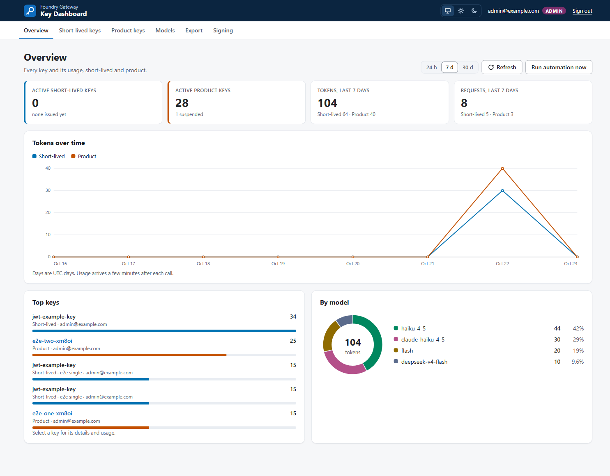
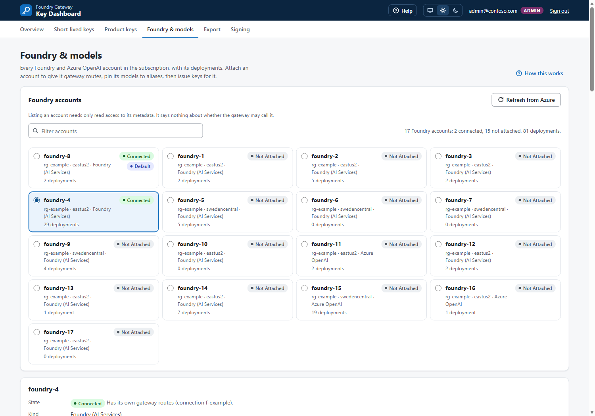
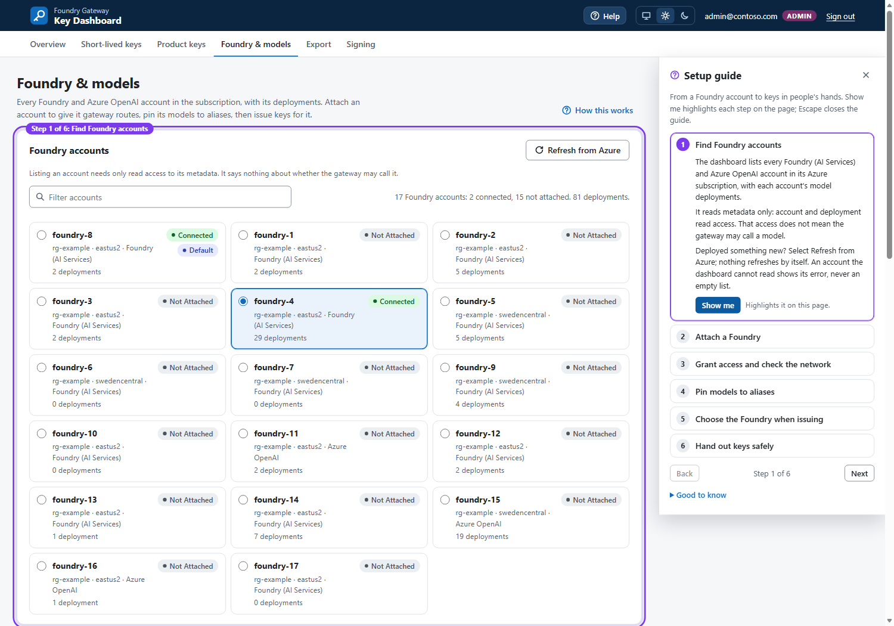
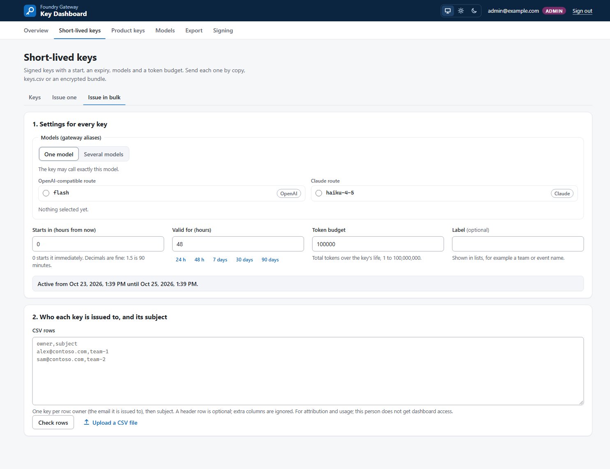
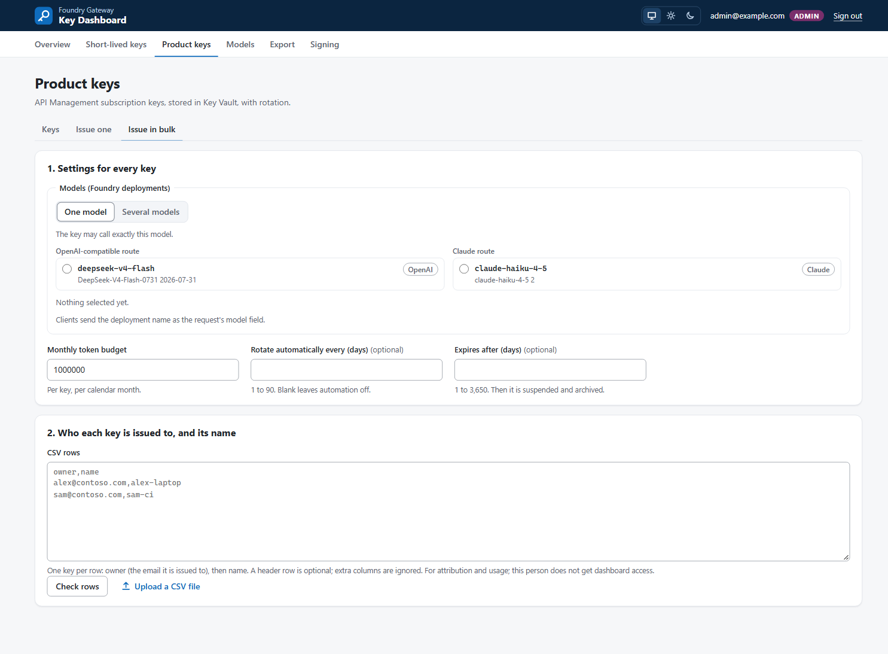

# liteAPIM (the admin key dashboard)

A web app for gateway administrators. It issues and manages two key types:

- **Short-lived keys:** signed HS256 keys, with a model allowlist, token budget, activation time
  and expiry. The signing secret is held in Key Vault.
- **Product keys:** API Management subscription keys held in Key Vault. They can be limited to
  one or several Foundry deployments, rotated between two slots, suspended, and enrolled in
  automatic rotation.

liteAPIM also shows per-key usage, separately for short-lived and product keys, for a preset
period or a custom range of UTC days, and exports a chargeback report as CSV. Administrators
distribute keys by copying a single key, downloading the script-compatible `keys.csv` and
key-free `index.csv`, or creating an encrypted bundle signed by a Key Vault key. The address in
handed-out keys is API Management's own URL, or a custom domain of API Management that an
administrator sets on **Settings**.

Decisions: [ADR-0013](adr/0013-admin-console.md) (core design),
[ADR-0014](adr/0014-console-on-container-apps.md) (Container Apps hosting),
[ADR-0015](adr/0015-key-dashboard.md) (dashboard),
[ADR-0016](adr/0016-admin-only-short-lived-keys.md) (admin-only access and distribution),
[ADR-0019](adr/0019-admin-gateway-url.md) (which gateway URL keys name) and
[ADR-0020](adr/0020-chargeback-usage-export.md) (the chargeback report).

---

## Access

**Only `Console.Admin` can open liteAPIM.** It requires Entra sign-in and the `Console.Admin`
app role. A signed-in person without that role gets 403 on every API; the UI displays
"liteAPIM is for administrators. Ask an admin for your key." The deploy script assigns
the operator and optional `-Admins` entries. It does not assign `Console.User`.

**Issued to** is the email address the administrator records for attribution and usage reporting.
It does not grant dashboard access. The recipient does not sign in to reveal the key: the
administrator copies it or distributes that recipient's row from `keys.csv`.

The app role comes from the platform-authenticated `X-MS-CLIENT-PRINCIPAL` header. The app
refuses a missing principal (401), a non-admin role (403) and a client-supplied principal header.

---

## Deploy

Prerequisites:
- the proof of concept deployed: APIM Standard v2, private vault `kv-poc-*`, and the VNet;
- Azure CLI signed in as someone who can create an app registration and assign roles in the
  resource group.

```powershell
# Default path: Container Apps. No IP restriction; Entra sign-in is still required.
pwsh scripts/Deploy-Console.ps1 -Subscription <subscription> -ResourceGroup <rg>

# Optionally assign additional admins and/or restrict inbound access.
pwsh scripts/Deploy-Console.ps1 -Subscription <subscription> -ResourceGroup <rg> `
    -Admins ops1@contoso.com,ops2@contoso.com -AllowedIp 203.0.113.7

# Alternate path: App Service web app and Function App on one plan.
pwsh scripts/Deploy-Console.ps1 -Subscription <subscription> -ResourceGroup <rg> `
    -Hosting AppService

# Basic v2 gateway with no VNet, Foundry in another resource group (P63, ADR-0021).
pwsh scripts/Deploy-Console.ps1 -Subscription <subscription> -ResourceGroup <rg> `
    -FoundryResourceGroup <foundry-rg> -FoundryAccountName <foundry> `
    -AppRegistrationName hackgw-key-console-basicv2 -CreateNetwork
```

Each install uses its own app registration. The script stops if the registration named by
`-AppRegistrationName` already has a redirect URI for another app, because it replaces the
registration's redirect URIs; `-TakeOverRegistration` moves the registration and ends sign-in on
the other app. With no VNet in the resource group the script stops unless `-CreateNetwork` is
given; that switch (Container Apps only) creates `vnet-console-<suffix>` with `snet-console`, a
private-endpoint subnet, the vault's private endpoint and the `privatelink.vaultcore.azure.net`
zone, and prints the billable ones first. Steps for that path are in
[INSTALL.md](INSTALL.md#existing-basic-v2-gateway).

The script, in order:

1. Finds the APIM instance, the vault and the VNet in the resource group, the Foundry (in the
   resource group, or as named by `-FoundryResourceGroup` and `-FoundryAccountName`), and the
   workspace of the Application Insights component that the gateway's `hackgw-appinsights`
   logger writes to.
2. Creates or updates the app registration `hackgw-key-console`, ensures the admin role, and
   sets "assignment required". The legacy `Console.User` role grants no dashboard access.
3. Assigns the signed-in operator `Console.Admin` and each `-Admins` entry `Console.Admin`.
4. Grants sign-in consent (`openid profile email`) for each administrator as a per-user
   `oauth2PermissionGrant`. This is for tenants that block user consent. If the grant fails, the
   script warns; then ask a tenant admin to grant admin consent once.
5. Builds the image in Azure Container Registry with ACR Tasks. Docker is not needed locally,
   and the registry admin user stays off.
6. Deploys only the selected hosting path:
   - **ContainerApps** (default): `infra/console.bicep`, a scale-to-zero web app and a scheduled
     job for automation;
   - **AppService**: `infra/console-appservice.bicep`, a web app and a Function App timer on one
     plan. This template builds, but the subscription's zero App Service quota in eastus2 blocks
     ARM validate/what-if and live deployment.

   Container Apps creates an environment injected into the POC VNet. App Service uses its
   delegated VNet-integration subnet. Each path creates liteAPIM with built-in Entra
   authentication and HTTPS only, and a managed identity with Key Vault Secrets Officer,
   Key Vault Crypto Officer and API Management Service Contributor.
7. Sets the redirect URI, waits for `/healthz`, and prints the URL.

`-AllowedIp` is optional. When supplied, it applies an inbound allow rule; omit it for Entra-only
access. The live installation has no IP restriction because the administrator's NAT egress address
rotates. The automation has no inbound endpoint.

**First sign-in as admin:** open **Settings**, then, under **Signing secret**, click **Migrate from
API Management**. This copies the gateway's current signing secret into Key Vault. Keys already
issued keep working.

---

## Using it

The screenshots in this guide predate the name liteAPIM, so their header shows the earlier name.

### Keys




liteAPIM lists active keys by default, with a separate archived view. **Issued to** labels
the intended holder; only administrators can see or reveal keys. For each key:

- **Reveal** returns the value and a ready-to-paste client setup.
- **Rotate** regenerates the slot not in use, then moves the stored value to it. The old value
  keeps working until the next rotation, so clients can switch without downtime.
- **Suspend / Resume** turns the subscription off and on.
- **Automation** sets "rotate every N days". Leave it blank to switch it off.
- **Run rotation automation now** rotates every key that is due.

Expired short-lived keys, revoked keys and expired product keys move to the archive automatically.
Product subscriptions are suspended before archiving. An admin can delete archived keys; the
automation deletes them 30 days after archive. Deletion is a Key Vault soft delete, not a purge.

A change to a product key reaches the gateway within about 20 seconds (16 s measured).

Usage charts cover 24 h, 7 d, 30 d or 90 d. The data is the gateway's `AppMetrics` table, an
Application Insights table that keeps 90 days at no charge, even though the workspace default is
30 days ([Learn: log tables with 90-day default retention](https://learn.microsoft.com/azure/azure-monitor/logs/data-retention-configure#log-tables-with-90-day-default-retention)).
Usage older than 90 days is removed. Raising the table's retention (up to 730 days of analytics
retention) keeps more, at an [extra cost](https://azure.microsoft.com/pricing/details/monitor/).
Check a workspace with `az monitor log-analytics workspace table show --name AppMetrics`.

**Custom range.** **Custom**, beside the presets on the Overview, both key pages and the key drawer,
shows **From (UTC)** and **To (UTC)**. Both days are whole UTC days and are included. The range
starts no earlier than 89 days before today and ends no later than today, because usage is kept
for 90 days; the hint under the dates states the earliest day. **Apply**, or Enter in a date
field, loads it. Two days or fewer are charted by the hour, longer ranges by the day; buckets
without usage show zero. The usage APIs take `days`, or `from` and `to` (`YYYY-MM-DD`), never
both; anything else is refused with 400. A range is queried with `datetime()` bounds that the
server writes from the checked days, and the same window as the query's `timespan` (U53). Answers
are cached for 60 seconds per kind and period.

### Chargeback report

The Overview's **Chargeback report** card downloads `chargeback-<from>-<to>.csv` for the period
chosen at the top of the page, for both key kinds or one ([ADR-0020](adr/0020-chargeback-usage-export.md)).
The file has a header row, then one row per key and model with usage in the period. There is no
totals row, so a sum or a pivot table over the file counts each token once.

| Columns | Content |
|---|---|
| `period_start_utc`, `period_end_utc` | The period, to the second; a custom range ends at 23:59:59 on its last day |
| `key_kind`, `key_name`, `key_id`, `issued_to` | `short-lived` or `product`; the Key Vault name; the `jti` or the subscription id; **Issued to** |
| `label`, `subject`, `budget_tokens`, `monthly_tokens`, `rotate_days`, `product`, `issued_by`, `valid_from_utc`, `expires_utc` | The key's descriptive tags, blank where a kind does not have them |
| `status`, `foundry_account`, `connection_id`, `granted_models` | Status as on the key lists (`active`, `scheduled`, `suspended`, `revoked`, `expired`, `archived`), or `unknown`; the Foundry and connection; the granted models or aliases |
| `model`, `prompt_tokens`, `completion_tokens`, `total_tokens`, `requests`, `first_seen_utc`, `last_seen_utc` | Usage of that model in the period |

- Usage whose key is no longer in Key Vault, for example a deleted key, is listed with status
  `unknown` and its key id, so the file adds up to the usage views. The Overview's **Top keys**
  names such usage **Unknown key `<key id>`**.
- The file is built from Key Vault tags and usage rows only; it holds no key value, token or
  secret. Cells beginning with `=`, `+`, `-`, `@`, a tab or a carriage return get a leading `'`,
  and quoting follows RFC 4180, as in `keys.csv`
  ([OWASP: CSV injection](https://owasp.org/www-community/attacks/CSV_Injection)).
- There is no price column. Foundry pricing varies by model, region and deployment type, and
  Claude models on Foundry are billed in CCU, so liteAPIM has no rate it could state as fact.
  Optional per-model rates are a "Later" roadmap entry.
- Token counts are the gateway's token metrics. For streamed responses API Management estimates
  them (UNKNOWNS U5), so the report allocates usage and does not reconcile with an Azure invoice.
- `POST /api/chargeback` takes `kind` (`all`, `jwt` or `product`) and `days`, or `from` and `to`. It
  is admin-only and audit-logged with the period, the kind and the number of rows. Without a Log
  Analytics workspace it answers 409 rather than an empty file.

### Foundry discovery, backend attachment and model pinning

**Foundry & models** lists the Foundry and Azure OpenAI accounts connected to this gateway's API
Management: the original (default) account and each attached account
([ADR-0018](adr/0018-connected-foundries-only.md)). Short-lived and product keys are issued only
for these. Its count covers connected Foundries and their deployments. **Refresh from Azure**
re-reads accounts and deployments from ARM; newly deployed models do not require an app redeploy.

**Connect another Foundry** opens a dialog that lists the other AIServices and Azure OpenAI
accounts liteAPIM discovers in the configured subscription, including accounts outside the
gateway's resource group, with search. An account liteAPIM cannot read is listed there with
its error, not omitted. These accounts do not appear in the connected list until they are
attached. If no Foundry is connected, the page shows an empty state with the same action.



The screenshot predates P58: it shows unattached accounts in the main list, where they no longer
appear.

1. In **Connect another Foundry**, choose the account by its name, resource group and region.
   Deployment names may repeat across accounts; the account's resource ID distinguishes them.
2. **Attach** provisions that account's APIM backends and isolated gateway routes. It does not
   give liteAPIM permission to grant Azure roles or open a firewall. After it succeeds, the
   dialog closes and the account is selected in the connected list. A failed attach keeps the
   dialog open with the error; selecting Attach again repairs a partial attempt.
3. Run the displayed operator setup command to grant the APIM managed identity inference access
   on the account. The dialog shows it before attaching, and the account's access section shows
   it afterwards. If the gateway's private DNS zones have no record for this account, the optional
   private-endpoint setup command creates the endpoint and records in its VNet.
4. Pin aliases for ready chat/messages deployments. Embeddings, image, audio, realtime and
   unsupported model formats remain visible with a reason; this gateway does not expose their
   modality-specific APIs.
5. **Test** makes a small inference request through APIM. Attachment is configuration, not proof
   that RBAC and networking work; a failure shows the next setup step.

The **Help** control explains these steps and highlights the relevant controls; its Attach step
highlights **Connect another Foundry**. Further steps cover the gateway URL on Settings, the usage
period with a custom range, and the chargeback report; **Show me** highlights each control, and
Escape closes the guide. **How attaching works** inside the dialog closes the
dialog first, because the guide cannot be used while a modal dialog is open. Discovery uses
metadata-only read permissions. Inference uses APIM's separate identity and per-account role.
Private endpoint setup is an operator action; no public-network or firewall settings are relaxed.



The original account keeps its existing `/v1`, `/claude` and `/poc/*` routes. Other accounts use
`/foundry/<connection-id>/...`. Returned handouts, CSVs and encrypted exports contain the correct
selected-account URLs. A short-lived key for one account is rejected at another account's routes;
product keys are linked only to their own account's APIs.

### Issue a short-lived key


The key is minted with the signing secret in Key Vault. Select a connected **Foundry**, then
choose one or several of that account's pinned aliases. Changing the Foundry clears the model
selection so a grant cannot accidentally use a different account's models.
**Starts in (hours from now)** defaults to 0; a future start is shown as **Scheduled**. The
gateway checks `nbf`, expiry, the model allowlist and token budget. This matches
`scripts/Keys.ps1`'s `Read-KeySettings`. **Revoke** adds the key ID to the gateway's denylist.

### Bulk issue and distribute




The **Bulk issue** form accepts CSV rows (`owner,subject` for short-lived keys;
`owner,name` for product keys). It submits at most 50 rows per request and displays names and
owners, not key values.

- **Download keys.csv** is the distribution file. It contains every key in the batch, with one
  row per recipient and the base URL, model(s), budget and validity columns. Send each person only
  their own row, then delete the file.
- **Download index.csv** has the recipient and key identifier, but no keys; it can be shared with
  co-organisers.
- **Export as encrypted bundle** uses the signed, passphrase-encrypted format below.

The browser keeps both CSV strings only in memory and discards them when the result closes, the
view changes or the page unloads. The files are not written to browser storage.

### Issue a product key


Select a connected **Foundry**, then one or several of its deployments. This creates/reuses a product whose policy allows
exactly those deployments and stores each APIM subscription's primary key in Key Vault.




### Client setup

The client setup shown by **Reveal** depends on the key type:

| Key | Route | Header | Claude Code |
|---|---|---|---|
| Signed | `/claude/v1/messages`, `/v1/chat/completions` | `Authorization: Bearer` | `ANTHROPIC_AUTH_TOKEN` |
| Product | `/poc/claude/v1/messages` | `x-api-key` | `ANTHROPIC_API_KEY` |

The setup also sets `ANTHROPIC_BASE_URL` and `ANTHROPIC_MODEL`, or `OPENAI_BASE_URL` and
`OPENAI_API_KEY` for the OpenAI-compatible route.

### Export bundle (admins)


To export:

1. Tick keys on the **Keys** tab.
2. Enter a recipient and a passphrase. If you leave the passphrase blank, liteAPIM generates
   one and shows it once.
3. Download the bundle.

The bundle is a JSON file:
- encrypted with AES-256-GCM under a key derived from the passphrase with scrypt;
- signed with ES256 by the Key Vault key `bundle-signing`, so the private key never leaves the
  vault.

**Send the passphrase by a different channel than the file.** Each export is logged with the
admin's name and the key names, never the values.

The recipient opens it:

```bash
# bundle-key.json: the public key from "Bundle verification key", obtained from liteAPIM,
# not from whoever sent the bundle
BUNDLE_PASSPHRASE='…' node scripts/open-bundle.mjs bundle.json --key bundle-key.json --out keys.json
```

`open-bundle.mjs` checks the signature before decrypting. It refuses a bundle whose header or
ciphertext was changed. It writes the keys to `--out` with owner-only permissions, never to the
terminal.

### Settings: gateway URL and signing secret (admins)

**Settings** has two cards: **Gateway URL** and **Signing secret**. The Signing page of earlier
versions is now the second card; `#/signing` still opens Settings.

#### Gateway URL (custom domain)

Handouts, Reveal's client setup, `keys.csv`, export bundles and each Foundry's base URL name
API Management's own URL (`GATEWAY_URL`, set at deploy) unless a custom domain replaces it
([ADR-0019](adr/0019-admin-gateway-url.md)).

1. Add the custom domain to API Management's **Gateway** endpoint first: in the Azure portal,
   the API Management instance, **Custom domains**
   ([Learn: configure a custom domain name](https://learn.microsoft.com/azure/api-management/configure-custom-domain)).
2. On **Settings**, enter `https://<hostname>` in **Gateway URL (custom domain)**, or select one of
   the gateway custom domains the card lists, then **Save**.

liteAPIM accepts only `https://` and a host name, lowercased: no path, query, user name,
port other than 443, IP address or wildcard. Before saving, it reads the API Management service
from ARM (`api-version=2024-05-01`) and checks that the host name is a gateway (`Proxy`) entry in
its `hostnameConfigurations` (U51); anything else is refused with 400. It never sends a request to
the URL and does not look it up in DNS; check that the name resolves to the gateway, for example
by calling it with a key. A Front Door or Application Gateway host name in front of API
Management is not in that list and cannot be set here; `admin.ps1` accepts a typed host name for
that case.

- The setting is the Key Vault secret `console-gateway-url`, holding `{"url":"https://…"}`. Each
  change is a new secret version, and the audit log records `set-gateway-url` or
  `reset-gateway-url` with the old and the new URL.
- **Reset to API Management URL** writes `{"url":null}`. The secret is never deleted, because a
  soft-deleted secret could not be written again under the same name (U54).
- The replica that saves a change uses it at once. Other replicas use it within 30 seconds; each
  checks the host name with ARM again when it reads the setting again, and falls back to the API
  Management URL if the domain is no longer listed. Browser tabs that are already open show the
  new URL in forms after a reload; the server builds every handout, so new keys carry it anyway.
- Keys handed out before a change are not rewritten. They keep working: API Management keeps
  answering on its default gateway host name, which cannot be removed, and on each configured
  custom domain ([Learn](https://learn.microsoft.com/azure/api-management/configure-custom-domain), U52).
- The Foundry connection test is a request liteAPIM sends itself, so it keeps calling the
  API Management URL.

#### Signing secret


The screenshot predates P59: it shows the earlier Signing page, now the **Signing secret** card on
Settings.

Key Vault holds the secret. API Management receives a copy as an encrypted named value, because
a Key Vault reference would need the vault firewall opened to trusted services (U36). The card
shows whether the two copies match, and has three actions:

- **Migrate:** first run only; copies the APIM secret into the vault.
- **Push:** copies the vault value to APIM.
- **Rotate:** writes a new secret to both. Every signed key issued before it stops working.

---

## Security notes

- **Sign-in:** every request except `/healthz` needs Entra sign-in. Plain HTTP is redirected to
  HTTPS.
- **Headers:**
  - a strict Content Security Policy, with no inline script;
  - `X-Frame-Options: DENY`;
  - `Referrer-Policy: same-origin`. A same-origin `Referer` is required: Container Apps
    authentication refuses cookie-authenticated browser POSTs without one (measured).
- **Secret handling:**
  - Secret values never reach the logs.
  - The app has no client secret and no registry password; it uses managed identities only.
  - Key Vault is reached only over the private network.
- **Access to liteAPIM:** remove the administrator's app-role assignment in Entra. Keys are
  distributed out-of-band by the administrator; the intended holder has no dashboard role.
- **Gateway URL:** keys name only API Management's URL or a host name ARM lists as one of its
  gateway custom domains; liteAPIM never sends a request to an admin-provided URL
  ([ADR-0019](adr/0019-admin-gateway-url.md)).
- **Chargeback report:** built from tags and usage rows, with formula-escaped cells; it holds no
  key value.
- **Network access:** the live deployment has no IP allowlist, because the administrator's public
  egress IP changes. Entra authentication and the `Console.Admin` role are still required.

## Measured on the deployment (2026-10-16 to 2026-10-23)

**Signed keys:**
- A console-issued key called `/v1` and `/claude` successfully (200).
- After **Revoke**, both routes returned 403.

**Product keys:**
- The primary key worked.
- **Rotate:** the new key worked; the old one kept working through the overlap. After a second
  rotation, the original key was rejected (401).
- **Suspend** returned 401, and **Resume** returned 200. Each change took effect within 16 s.

**Rotation sweep:** it rotated a key that was due, and rotated nothing on a second run.

**Bundles:**
- A genuine bundle opened.
- A bundle with an edited header was refused (bad signature).
- A bundle with a flipped ciphertext byte was refused.

**Historical P46 role test:** before ADR-0016, `Console.User` saw only its own keys and every
admin action returned 403. That behaviour was superseded: liteAPIM is now admin-only, and
owners cannot sign in to reveal keys.

**ADR-0016 live checks (2026-10-23):**
- No IP restrictions are configured. `/healthz` returned 200 from both the workstation and the
  private runner VM; `/api/me` returned 401 without sign-in.
- A bulk short-lived key with a one-hour delay had a future JWT `nbf`, appeared as `scheduled`,
  and was included in `keys.csv`; its key-free index did not contain the key. Revoke returned 200.
- A bulk product key appeared in `keys.csv`, not in `index.csv`; archive and delete both returned
  200.
- The runner VM resolved the vault to `10.61.2.7` and Foundry to `10.61.2.4`. The vault responded
  over its private endpoint; dashboard traffic from the VM reached the app.

The interface screenshots were captured from the live UI on 2026-10-23/24. Account/resource
names, subscription IDs and header identities are replaced with generic examples before capture;
no key values are shown.
