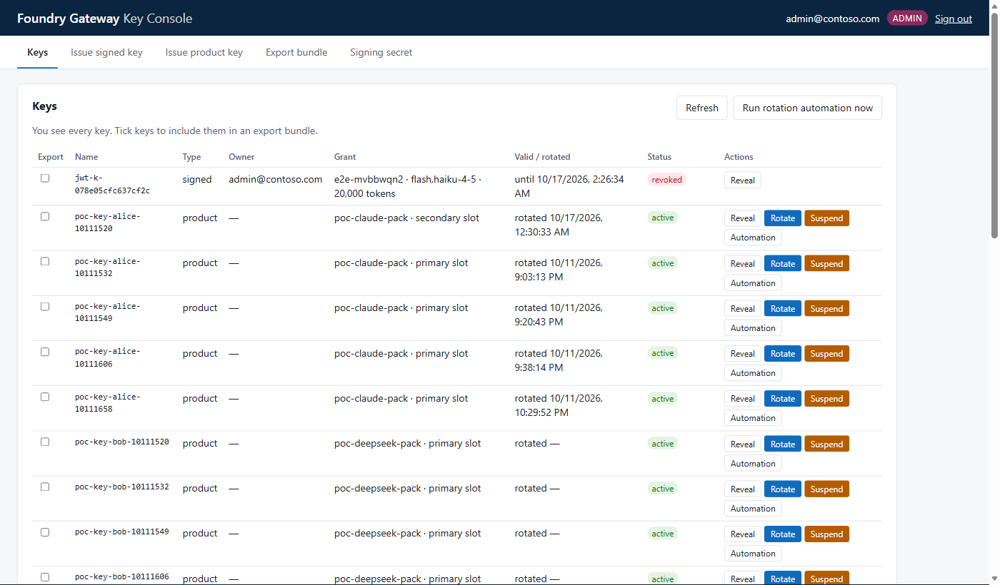
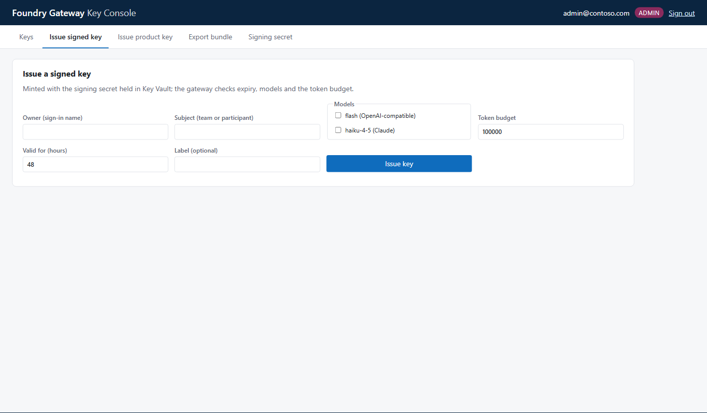
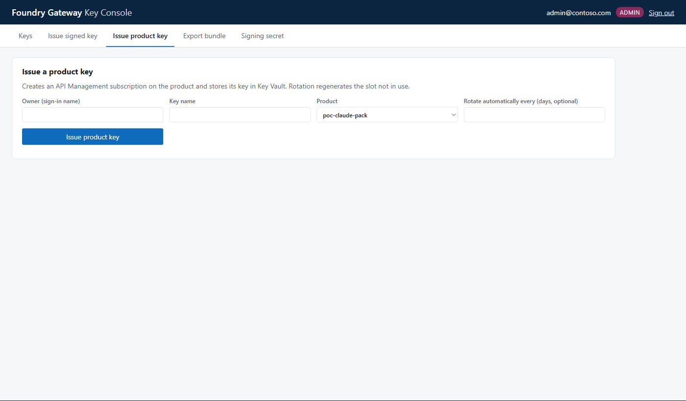
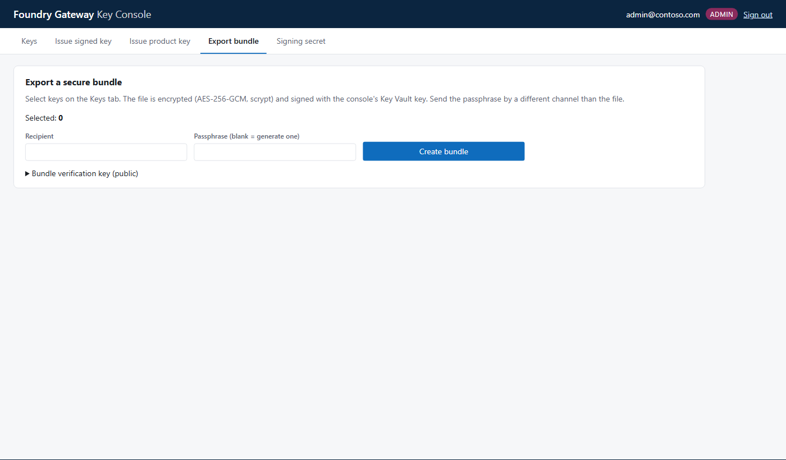

# Key Console

A web app for the people who run the gateway. One place to issue, reveal, revoke and rotate
**both** kinds of participant key, behind Entra ID sign-in and two app roles:

- **Signed keys:** the gateway's original HS256 keys, each with an expiry, a model list and a
  token budget. The console keeps the **signing secret in Key Vault** and mints the keys there.
- **Product keys:** API Management subscription keys on a product pack. The value is stored in
  Key Vault and rotated on a two-slot schedule. Per key, an admin can switch on **rotation
  automation**.

Only admins can export. An export is an **encrypted bundle signed by a Key Vault key held for
the admins**, so the recipient can check who sent it and that nobody changed it.

Decisions: [ADR-0013](adr/0013-admin-console.md) (design) and
[ADR-0014](adr/0014-console-on-container-apps.md) (hosting on Azure Container Apps).

> Branch `feature/admin-console` only. It builds on the proof of concept in
> `poc/products-keyvault/`, and needs its private vault, network and product packs.

---

## Roles

| Can… | `Console.Admin` | `Console.User` |
|---|---|---|
| See keys | every key | only keys whose owner is their sign-in name |
| Reveal a key and its client setup | any key | their own (another person's key returns 404) |
| Issue signed or product keys, revoke, rotate, suspend or resume | yes | no (403) |
| Switch rotation automation, run the sweep | yes | no (403) |
| Manage the signing secret | yes | no (403) |
| **Export a bundle** | yes | no (403) |

The role comes from the `roles` claim that Container Apps authentication puts in the
`X-MS-CLIENT-PRINCIPAL` header. That header comes from the platform; the app trusts it only when
authentication is enabled, and a request carrying a spoofed header is still refused (401). With
neither role, the user is refused at sign-in, because the app registration requires an
assignment.

---

## Deploy

Prerequisites:
- the proof of concept deployed: APIM Standard v2, private vault `kv-poc-*`, and the VNet;
- Azure CLI signed in as someone who can create an app registration and assign roles in the
  resource group.

```powershell
pwsh scripts/Deploy-Console.ps1 -Subscription <subscription> -ResourceGroup <rg> `
    -Users alice@contoso.com,bob@contoso.com
```

The script, in order:

1. Finds the APIM instance, the vault and the VNet in the resource group.
2. Creates or updates the app registration `hackgw-key-console` with the roles `Console.Admin`
   and `Console.User`, and sets "assignment required".
3. Assigns you `Console.Admin` and each `-Users` entry `Console.User`.
4. Grants sign-in consent (`openid profile email`) for each person as a per-user
   `oauth2PermissionGrant`. This is for tenants that block user consent. If the grant fails, the
   script warns; then ask a tenant admin to grant admin consent once.
5. Builds the image in Azure Container Registry with ACR Tasks. Docker is not needed locally,
   and the registry admin user stays off.
6. Deploys `infra/console.bicep`, which creates:
   - a Container Apps environment injected into a new subnet of the POC VNet, so the private
     vault resolves and is reachable;
   - the app, with built-in Entra authentication and HTTPS only;
   - a managed identity with Key Vault Secrets Officer, Key Vault Crypto Officer and API
     Management Service Contributor.
7. Sets the redirect URI, waits for `/healthz`, and prints the URL.

**First sign-in as admin:** open **Signing secret**, then click **Migrate from API Management**.
This copies the gateway's current signing secret into Key Vault. Keys already issued keep
working.

---

## Using it

### Keys



Admins see every key; a user sees only their own and no export column. For each key:

- **Reveal** returns the value and a ready-to-paste client setup.
- **Rotate** regenerates the slot not in use, then moves the stored value to it. The old value
  keeps working until the next rotation, so clients can switch without downtime.
- **Suspend / Resume** turns the subscription off and on.
- **Automation** sets "rotate every N days". Leave it blank to switch it off.
- **Run rotation automation now** rotates every key that is due. The app also runs this sweep
  on its own every `ROTATION_SWEEP_MINUTES` minutes (default 60, `0` turns it off).

A change to a product key reaches the gateway within about 20 seconds (16 s measured).

### Issue a signed key



The key is minted with the secret in Key Vault. The gateway checks its expiry, its models and
its token budget, exactly as for keys from `admin.ps1`. **Revoke** adds the key to the
gateway's denylist, and both routes then return 403.

### Issue a product key



This creates an APIM subscription on the pack and stores its primary key in Key Vault.

### Client setup

The client setup shown by **Reveal** depends on the key type:

| Key | Route | Header | Claude Code |
|---|---|---|---|
| Signed | `/claude/v1/messages`, `/v1/chat/completions` | `Authorization: Bearer` | `ANTHROPIC_AUTH_TOKEN` |
| Product | `/poc/claude/v1/messages` | `x-api-key` | `ANTHROPIC_API_KEY` |

The setup also sets `ANTHROPIC_BASE_URL` and `ANTHROPIC_MODEL`, or `OPENAI_BASE_URL` and
`OPENAI_API_KEY` for the OpenAI-compatible route.

### Export bundle (admins)



To export:

1. Tick keys on the **Keys** tab.
2. Enter a recipient and a passphrase. If you leave the passphrase blank, the console generates
   one and shows it once.
3. Download the bundle.

The bundle is a JSON file:
- encrypted with AES-256-GCM under a key derived from the passphrase with scrypt;
- signed with ES256 by the Key Vault key `bundle-signing`, so the private key never leaves the
  vault.

**Send the passphrase by a different channel than the file.** Each export is logged with the
admin's name and the key names, never the values.

The recipient opens it:

```bash
# bundle-key.json: the public key from "Bundle verification key", obtained from the console,
# not from whoever sent the bundle
BUNDLE_PASSPHRASE='…' node scripts/open-bundle.mjs bundle.json --key bundle-key.json --out keys.json
```

`open-bundle.mjs` checks the signature before decrypting. It refuses a bundle whose header or
ciphertext was changed. It writes the keys to `--out` with owner-only permissions, never to the
terminal.

### Signing secret (admins)


Key Vault holds the secret. API Management receives a copy as an encrypted named value, because
a Key Vault reference would need the vault firewall opened to trusted services (U36). The page
shows whether the two copies match, and has three actions:

- **Migrate:** first run only; copies the APIM secret into the vault.
- **Push:** copies the vault value to APIM.
- **Rotate:** writes a new secret to both. Every signed key issued before it stops working.

---

## Security notes

- **Sign-in:** every request except `/healthz` needs Entra sign-in. Plain HTTP is redirected to
  HTTPS.
- **Headers:**
  - a strict Content Security Policy, with no inline script;
  - `X-Frame-Options: DENY`;
  - `Referrer-Policy: same-origin`. A same-origin `Referer` is required: Container Apps
    authentication refuses cookie-authenticated browser POSTs without one (measured).
- **Secret handling:**
  - Secret values never reach the logs.
  - The app has no client secret and no registry password; it uses managed identities only.
  - Key Vault is reached only over the private network.
- **Revoking access:** remove a person's app-role assignment in Entra. Their next request is
  refused once their session ends.

## Measured on the deployment (2026-10-16 and 2026-10-17)

**Signed keys:**
- A console-issued key called `/v1` and `/claude` successfully (200).
- After **Revoke**, both routes returned 403.

**Product keys:**
- The primary key worked.
- **Rotate:** the new key worked; the old one kept working through the overlap. After a second
  rotation, the original key was rejected (401).
- **Suspend** returned 401, and **Resume** returned 200. Each change took effect within 16 s.

**Rotation sweep:** it rotated a key that was due, and rotated nothing on a second run.

**Bundles:**
- A genuine bundle opened.
- A bundle with an edited header was refused (bad signature).
- A bundle with a flipped ciphertext byte was refused.

**User role:** the user saw only their own keys. Every admin action returned 403.
