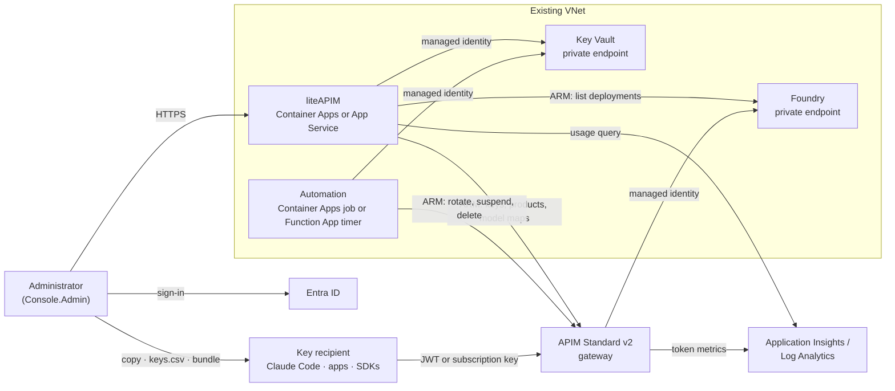

# liteAPIM (the admin key dashboard): install and setup

This guide deploys liteAPIM beside an API Management gateway, then issues a key and tests it with
Claude Code. It covers two starting points: an existing gateway environment, or a new isolated
test environment. The liteAPIM installer does not create the gateway or the product-key vault.
Choose the path below before running Azure commands.

| Step | Result | Time |
|---|---|---|
| [0. Try it locally](#0-try-it-locally-no-azure) | The real UI on sample data, no Azure | 1 min |
| [1. Network, Foundry and APIM](#1-network-foundry-and-api-management) | VNet, private Foundry, APIM Standard v2 | 45–60 min |
| [2. Gateway](#2-gateway) | Short-lived key routes `/v1` and `/claude` | 5 min |
| [3. Product routes and Key Vault](#3-product-routes-and-key-vault) | Product key routes `/poc/*`, private vault | 10 min |
| [4. liteAPIM](#4-liteapim) | liteAPIM, automation, sign-in | 10 min |
| [5. First sign-in](#5-first-sign-in) | Signing secret in Key Vault | 1 min |
| [6. Issue and use a key](#6-issue-and-use-a-key) | A key working in Claude Code | 5 min |

Decisions: [ADR-0013](adr/0013-admin-console.md), [ADR-0014](adr/0014-console-on-container-apps.md),
[ADR-0015](adr/0015-key-dashboard.md), [ADR-0016](adr/0016-admin-only-short-lived-keys.md),
[ADR-0019](adr/0019-admin-gateway-url.md).
Day-to-day use: [CONSOLE.md](CONSOLE.md).

---

## Choose your starting point

| Starting point | What you need | Follow |
|---|---|---|
| An existing API Management gateway | APIM, Foundry, VNet, workspace and the product-key setup with a private Key Vault in the same resource group | Set the resource variables below. If the gateway routes and product-key setup already work, continue at [4. liteAPIM](#4-liteapim). Otherwise run the missing [2. Gateway](#2-gateway) or [3. Product routes and Key Vault](#3-product-routes-and-key-vault) step |
| An existing Basic v2 gateway (no VNet) | A Basic v2 APIM with its gateway workspace, and a Foundry with public network access, possibly in another resource group | [Existing Basic v2 gateway](#existing-basic-v2-gateway), then [5. First sign-in](#5-first-sign-in) and [6. Issue and use a key](#6-issue-and-use-a-key) |
| A new test environment | A subscription with enough quota, and an existing Claude deployment whose provider metadata can be read | Run [1. Network, Foundry and API Management](#1-network-foundry-and-api-management), then continue through steps 2–6 |

The new test environment creates billable APIM Standard v2 capacity, model deployments, private
endpoints and networking. Check the current [Azure pricing](https://azure.microsoft.com/pricing/)
and regional quota before deployment. The example does not deploy into an existing resource
group safely: use a dedicated test resource group, and do not delete a resource group that holds
shared services.

## Architecture


The illustration predates the name liteAPIM: its admin dashboard box is liteAPIM.

In the illustration, key recipients obtain a token from Entra ID (flow 7) and APIM validates
Entra tokens. In this design they do not. A recipient has no Entra role. The administrator
gives each recipient a key issued by liteAPIM, and APIM checks that key:

- a **short-lived key** is an HS256 JWT signed with the gateway's secret, sent as
  `Authorization: Bearer`;
- a **product key** is an APIM subscription key, sent as `x-api-key` (Claude route) or `api-key`
  (OpenAI route).

Entra ID signs in **administrators** to liteAPIM. The diagram below shows the same design as
text:



---

## Requirements

| Requirement | Why |
|---|---|
| PowerShell 7, Azure CLI 2.60+, Node.js 20+ | PowerShell runs the deployment scripts; Node.js runs the local demo |
| An Azure subscription, selected with `az account set` | The scripts deploy into the selected subscription |
| Contributor and User Access Administrator (or Owner) on the target resource group | The templates create resources and role assignments |
| Permission to create an Entra app registration and assign its app roles | liteAPIM sign-in ([`Deploy-Console.ps1`](../scripts/Deploy-Console.ps1)) |
| Permission to create a custom role definition and role assignment at subscription scope | The operator grants liteAPIM read-only Foundry account/deployment discovery; see the script requirements |
| Quota for Container Apps (default) or App Service B1 | The web app host; the test subscription had zero App Service quota ([U40](UNKNOWNS.md)) |
| Existing gateway path: APIM, Foundry, VNet, workspace, and private POC vault | `Deploy-Console.ps1` adopts these resources; it does not create them |
| New test path: Claude model deployment metadata, Claude deployment access and model quota | The example deploys a new Claude deployment from the provider metadata |

Check tool versions before making changes. The local demo needs Node.js only; Azure sign-in is
needed for steps 1–4:

```powershell
$PSVersionTable.PSVersion
az version
node --version
```

---

## 0. Try it locally (no Azure)

```powershell
git clone -b release/key-dashboard https://github.com/naveenneog/foundry-hackathon-gateway
cd foundry-hackathon-gateway
npm run dashboard:demo        # http://127.0.0.1:8090/
```

[`scripts/dashboard-demo.mjs`](../scripts/dashboard-demo.mjs) runs the real server and UI against
the in-memory fakes the unit tests use, with seeded keys and synthetic usage. Every request is
treated as a signed-in admin, so it listens on `127.0.0.1` only. Nothing is sent to Azure, and
issued keys are not valid at any gateway. `PORT=8091` changes the port.

---

## Azure deployment: select your subscription and starting path

Continue here only for an Azure deployment. Run PowerShell 7 from the repository root, and keep
the same PowerShell session open through the following steps because later commands use these
variables. Sign in, select the subscription explicitly, then choose `existing` or `new`.

```powershell
az login
$subscriptionId = Read-Host 'Subscription ID'
az account set --subscription $subscriptionId
if ($LASTEXITCODE -ne 0) { throw 'Could not select that subscription.' }
az account show --query '{name:name,id:id,tenant:tenantId}' -o table
$setupPath = Read-Host 'Type existing or new'
if ($setupPath -notin @('existing', 'new')) { throw "Type 'existing' or 'new'." }
if ($setupPath -eq 'existing') {
    $resourceGroup = Read-Host 'Resource group containing APIM, Foundry, VNet and Key Vault'
    $apimName = Read-Host 'API Management instance name'
    $foundryAccountName = Read-Host 'Foundry account name'
    $gatewayVnetName = Read-Host 'Gateway virtual network name'
}
```

Check the displayed subscription and tenant before continuing. On a shared machine, isolate the
Azure CLI profile before `az login`; see [Azure CLI configuration](https://learn.microsoft.com/cli/azure/azure-cli-configuration).
The deployment script refuses to continue when the active tenant does not match the selected
subscription.

## Existing Basic v2 gateway

This path installs the product routes, the private vault and liteAPIM beside an API Management
Basic v2 instance that has no VNet ([ADR-0021](adr/0021-liteapim-own-network-and-cross-group-foundry.md)).
It was run on 2026-10-27 against this project's Basic v2 instance; the results are in
[STATUS, P63](STATUS.md).

How it differs from the other paths:

- **Foundry.** Basic v2 has no outbound virtual network option, so the gateway cannot reach a
  Foundry whose public network access is Disabled ([PRIVATE-ENDPOINT.md](PRIVATE-ENDPOINT.md)).
  This path needs a Foundry with public network access, which APIM calls with its managed
  identity (Cognitive Services User on the account). The Foundry can be in another resource
  group.
- **Vault.** The product-key vault is still created with public network access Disabled. With
  `-CreateNetwork`, the liteAPIM installer creates a VNet used only by liteAPIM, with the vault's
  private endpoint and its private DNS zone. liteAPIM and its automation job reach the vault
  through it. No runner VM or NAT gateway is created, so the runner-based POC scripts
  (`Invoke-PocRunner.ps1`) have no path to the vault here; keys are issued and rotated in
  liteAPIM.
- **App registration.** Each install needs its own app registration. The installer replaces the
  registration's redirect URI, and it stops if the registration already signs in another app.
- **Limits.** Basic v2 allows 200 products, 15,000 subscriptions and 5,000 named values per
  instance, against 500, 25,000 and 10,000 on Standard v2
  ([Azure subscription and service limits](https://learn.microsoft.com/azure/azure-resource-manager/management/azure-subscription-service-limits);
  [U56](UNKNOWNS.md)). liteAPIM creates one product per model set and one subscription per
  product key.

**Inputs and checks.** Run from the repository root in PowerShell 7:

```powershell
$subscriptionId = Read-Host 'Subscription ID'
$resourceGroup = Read-Host 'Resource group of the Basic v2 API Management instance'
$apimName = Read-Host 'API Management instance name'
$foundryResourceGroup = Read-Host 'Resource group of the Foundry account'
$foundryAccountName = Read-Host 'Foundry account name'
$registrationName = Read-Host 'App registration name for this liteAPIM, for example hackgw-key-console-basicv2'
az account set --subscription $subscriptionId
az apim show --resource-group $resourceGroup --name $apimName --query '{sku:sku.name,network:virtualNetworkType}' -o table
az cognitiveservices account show --resource-group $foundryResourceGroup --name $foundryAccountName --query properties.publicNetworkAccess -o tsv
$apimPrincipalId = az apim show --resource-group $resourceGroup --name $apimName --query identity.principalId -o tsv
$foundryId = az cognitiveservices account show --resource-group $foundryResourceGroup --name $foundryAccountName --query id -o tsv
az role assignment list --assignee $apimPrincipalId --scope $foundryId --query '[].roleDefinitionName' -o tsv
az network vnet list --resource-group $resourceGroup --query '[].name' -o tsv
```

Expected: `BasicV2` and `None`; `Enabled`; `Cognitive Services User`; no VNet listed. If the role
is missing, `scripts/Connect-Foundry.ps1` grants it (step 6). If the gateway routes `/v1` and
`/claude` are missing, run [2. Gateway](#2-gateway) first.

**Product routes and vault.** `-FoundryResourceGroup` names the Foundry's resource group. Do not
run the runner's `Deploy` step on this path:

```powershell
pwsh .\poc\products-keyvault\scripts\Deploy-Poc.ps1 -Subscription $subscriptionId -ResourceGroup $resourceGroup -ApimName $apimName -FoundryAccountName $foundryAccountName -FoundryResourceGroup $foundryResourceGroup
```

Expected: the vault name `kv-poc-…` and the URLs of `/poc/claude`, `/poc/v1` and
`/poc/probe/whoami`. It adds the APIs `poc-claude`, `poc-openai` and `poc-probe` and the products
`poc-claude-pack`, `poc-deepseek-pack` and `poc-tiny-pack`; existing APIs, products and named
values are not changed.

**liteAPIM, with its own network:**

```powershell
pwsh .\scripts\Deploy-Console.ps1 -Subscription $subscriptionId -ResourceGroup $resourceGroup -FoundryResourceGroup $foundryResourceGroup -FoundryAccountName $foundryAccountName -AppRegistrationName $registrationName -CreateNetwork
```

Without `-CreateNetwork`, the installer stops with "has no virtual network". With it, the
installer prints the billable resources before it creates them:

```text
Creating liteAPIM's network vnet-console-<suffix> (10.65.0.0/24). Billable resources:
  billable: VNet vnet-console-<suffix> with subnets snet-console and snet-pe: no charge
  billable: private endpoint pe-kv-poc-<id> for the vault: per hour, plus per GB processed
  billable: private DNS zone privatelink.vaultcore.azure.net: per zone per month, plus per million queries
```

The last line is `liteAPIM (ContainerApps): https://ca-console-<suffix>.<environment>.<region>.azurecontainerapps.io`.
`-NetworkPrefix` sets another address space (a private IPv4 `/16` to `/26` outside
`10.61.0.0/16`); the default `10.65.0.0/24` gives `snet-console` `10.65.0.0/27` (a
workload-profiles Container Apps environment needs a delegated `/27` at least,
[U58](UNKNOWNS.md)) and `snet-pe` `10.65.0.32/28`. If the resource group already holds a
`privatelink.vaultcore.azure.net` zone, it is reused.

Resources this path creates, with list prices in East US 2 from the Azure Retail Prices API
(read 2026-10-26; usage-based items depend on traffic):

| Resource | Price |
|---|---|
| Private endpoint for the vault | USD 0.01 per hour (about USD 7.30 per 730-hour month), plus USD 0.01 per GB processed |
| Private DNS zone `privatelink.vaultcore.azure.net` | USD 0.50 per zone per month, plus USD 0.40 per million queries |
| Container registry, Basic | USD 0.1666 per day (about USD 5.07 per month) |
| Container Apps environment (Consumption profile only), app and job | No environment charge without a Dedicated profile. Active vCPU USD 0.000024 per second, memory USD 0.000003 per GiB-second, USD 0.40 per million requests, after the monthly free grant of 180,000 vCPU-seconds, 360,000 GiB-seconds and 2 million requests per subscription ([Container Apps billing](https://learn.microsoft.com/azure/container-apps/billing)) |
| Key Vault, Standard | USD 0.03 per 10,000 operations |
| Log Analytics workspace `log-ca-console-<suffix>` | USD 2.76 per GB ingested after the first 5 GB per month |
| VNet and subnets | No charge |

Then continue at [5. First sign-in](#5-first-sign-in).

**Remove this path's liteAPIM.** These commands delete only what the liteAPIM installer created
here, in dependency order. The product routes, the vault and its keys stay;
`Remove-Poc.ps1` removes those. Delete the DNS zone only if this install created it:

```powershell
$suffix = ($apimName -split '-')[-1]
$job = "job-ca-console-$suffix"; if ($job.Length -gt 32) { $job = $job.Substring(0, 32) }
$environment = "cae-ca-console-$suffix"; if ($environment.Length -gt 32) { $environment = $environment.Substring(0, 32) }
$vaultName = az keyvault list --resource-group $resourceGroup --query '[].name' -o json | ConvertFrom-Json | Where-Object { $_ -like 'kv-poc-*' } | Select-Object -First 1
az containerapp delete --resource-group $resourceGroup --name "ca-console-$suffix" --yes
az containerapp job delete --resource-group $resourceGroup --name $job --yes
az containerapp env delete --resource-group $resourceGroup --name $environment --yes
az network private-endpoint delete --resource-group $resourceGroup --name "pe-$vaultName"
az network private-dns link vnet delete --resource-group $resourceGroup --zone-name privatelink.vaultcore.azure.net --name "link-vnet-console-$suffix" --yes
az network private-dns zone delete --resource-group $resourceGroup --name privatelink.vaultcore.azure.net --yes
az network vnet delete --resource-group $resourceGroup --name "vnet-console-$suffix"
az acr delete --resource-group $resourceGroup --name "crconsole$suffix" --yes
az identity delete --resource-group $resourceGroup --name "id-ca-console-$suffix-pull"
az monitor log-analytics workspace delete --resource-group $resourceGroup --workspace-name "log-ca-console-$suffix" --yes
$appId = az ad app list --display-name $registrationName --query '[0].appId' -o tsv
az ad app delete --id $appId
```

Expected: each command returns without an error. The role assignments of the deleted identities
remain listed as "Identity not found" until removed under **Access control (IAM)**, including
the subscription-level Foundry metadata discovery assignment. Remove them before installing
liteAPIM again under the same names: a new install's assignments have the same names, and ARM
refuses them with `RoleAssignmentUpdateNotPermitted` while the old ones exist (measured
2026-10-27; ROADMAP P65).

## 1. Network, Foundry and API Management

If you chose `existing`, skip this section. If you chose `new`, continue with a dedicated test
resource group.

liteAPIM runs inside the gateway's VNet, where Key Vault and Foundry are reachable through
private endpoints. [`infra/examples/private-foundry-test.bicep`](../infra/examples/private-foundry-test.bicep)
creates the whole environment in one resource group:
- the VNet and subnets;
- a Foundry account with an OpenAI-route and a Claude deployment;
- the Foundry private endpoint and DNS zones;
- an APIM Standard v2 instance with VNet integration.

The template requires provider metadata from a Claude deployment that already exists in your
subscription. Use a monitored contact email for the APIM publisher address.
The following commands prompt for the missing names, retrieve that metadata from Azure Resource
Manager, create `params.json`, and deploy into a dedicated resource group. They do not retrieve a
model key.

```powershell
$location = 'eastus2'
$publisherEmail = Read-Host 'APIM publisher contact email'
$sourceResourceGroup = Read-Host 'Resource group containing the existing Claude deployment'
$sourceFoundryName = Read-Host 'Foundry account containing that deployment'
$sourceDeploymentName = Read-Host 'Claude deployment name'
$subscriptionId = az account show --query id -o tsv
$deploymentUrl = "https://management.azure.com/subscriptions/$subscriptionId/resourceGroups/$sourceResourceGroup/providers/Microsoft.CognitiveServices/accounts/$sourceFoundryName/deployments/$sourceDeploymentName`?api-version=2025-12-01"
$claudeProviderDataJson = az rest --method get --url $deploymentUrl --query properties.modelProviderData -o json
if ($LASTEXITCODE -ne 0 -or -not $claudeProviderDataJson) { throw 'Could not read Claude model provider metadata. Check the names and your Reader access.' }
$parameters = @{
    '$schema' = 'https://schema.management.azure.com/schemas/2019-04-01/deploymentParameters.json#'
    contentVersion = '1.0.0.0'
    parameters = @{
        publisherEmail = @{ value = $publisherEmail }
        claudeProviderData = @{ value = ($claudeProviderDataJson | ConvertFrom-Json) }
    }
}
$parameters | ConvertTo-Json -Depth 20 | Set-Content -Path .\params.json -Encoding utf8
$resourceGroup = Read-Host 'New, dedicated test resource group name'
az group create --name $resourceGroup --location $location --output table
if ($LASTEXITCODE -ne 0) { throw 'Resource group creation failed.' }
az deployment group create --name gateway-test-stack --resource-group $resourceGroup --template-file .\infra\examples\private-foundry-test.bicep --parameters '@params.json' --output table
if ($LASTEXITCODE -ne 0) { throw 'Test environment deployment failed. Review the deployment operations in Azure before retrying.' }
$deploymentOutputs = az deployment group show --resource-group $resourceGroup --name gateway-test-stack --query properties.outputs -o json | ConvertFrom-Json
if ($LASTEXITCODE -ne 0 -or -not $deploymentOutputs.apimName.value) { throw 'The deployment completed without the expected outputs. Check the deployment in the Azure portal.' }
```

If Azure reports a quota or model-capacity error, stop and check regional quota before retrying.
The APIM instance can take 30–45 minutes to provision. Check and record the output values:

```powershell
$apimName = $deploymentOutputs.apimName.value
$foundryAccountName = $deploymentOutputs.foundryName.value
$gatewayUrl = $deploymentOutputs.gatewayUrl.value
$gatewayVnetName = 'vnet-hackgw-pe'
Write-Host "APIM: $apimName"
Write-Host "Foundry: $foundryAccountName"
Write-Host "Gateway URL: $gatewayUrl"
```

Use `apimName` and `foundryName` in steps 2 and 3.
The template source and its parameter requirements are documented in
[`private-foundry-test.bicep`](../infra/examples/private-foundry-test.bicep). For an existing
network or Foundry, follow [PRIVATE-ENDPOINT.md → Steps with the Azure CLI](PRIVATE-ENDPOINT.md#steps-with-the-azure-cli)
instead of creating another test stack.

The Claude route needs a v2 tier
([ADR-0009](adr/0009-claude-code-connection.md)).

## 2. Gateway

```powershell
.\admin.ps1
```

Choose **1. Deploy / update the gateway**. Select the API Management instance and Foundry
account when prompted. When deployment completes, confirm that both the `/v1` and `/claude`
routes have a model pinned. The detailed operator workflow is in [RUNBOOK.md](RUNBOOK.md).

This publishes the short-lived key routes (`/v1`, `/claude`), the policies and the signing secret,
and pins the first model aliases. It is the same deployment as the terminal workflow
([RUNBOOK.md](RUNBOOK.md)).

## 3. Product routes and Key Vault

Product keys use the routes, products and private Key Vault from the products proof of concept
([poc/products-keyvault/SETUP.md](../poc/products-keyvault/SETUP.md)):

Use the names you selected in the subscription block. For the new test environment, use the
deployment outputs from step 1:

```powershell
$apimName = $deploymentOutputs.apimName.value
$foundryAccountName = $deploymentOutputs.foundryName.value
$target = @{ Subscription = $subscriptionId; ResourceGroup = $resourceGroup }
pwsh .\poc\products-keyvault\scripts\Deploy-Poc.ps1 @target -ApimName $apimName -FoundryAccountName $foundryAccountName
```

`Deploy-Poc.ps1` prints the vault name. The vault is created with public network access
disabled. liteAPIM reaches it through the private endpoint and DNS zone created by the runner's
`Deploy` step. Set the vault name printed by `Deploy-Poc.ps1`, then run:

```powershell
$vaultName = Read-Host 'Vault name printed by Deploy-Poc.ps1'
pwsh .\poc\products-keyvault\scripts\Invoke-PocRunner.ps1 -Subscription $subscriptionId -ResourceGroup $resourceGroup -ApimName $apimName -VaultName $vaultName -VnetName $gatewayVnetName -Step Deploy
```

The runner VM is needed only for the POC scripts. Deallocate it after setup:

```powershell
az vm deallocate --resource-group $resourceGroup --name vm-poc-runner --no-wait
```

## 4. liteAPIM

```powershell
# Default: Container Apps. The deployment script discovers APIM, the vault and VNet in this resource group.
pwsh .\scripts\Deploy-Console.ps1 -Subscription $subscriptionId -ResourceGroup $resourceGroup

# Options
#   -Admins ops1@contoso.com,ops2@contoso.com   more administrators (Console.Admin)
#   -AllowedIp 203.0.113.7                       accept only this address (or a /24-/32 range)
#   -Hosting AppService                          web app + Function App timer on one B1 plan
```

[`Deploy-Console.ps1`](../scripts/Deploy-Console.ps1) finds the APIM instance, the vault, the
Foundry account, the gateway's workspace and the VNet in the resource group. It then:

1. Creates the app registration `hackgw-key-console`, with "assignment required", and assigns
   you and any `-Admins` the `Console.Admin` role.
2. Records per-user sign-in consent for each administrator, for tenants that block user consent.
   If that fails, a tenant admin grants consent to the app once.
3. Adds token-usage diagnostics to the product routes
   ([`infra/console-telemetry.bicep`](../infra/console-telemetry.bicep)); no headers or bodies
   are logged.
4. Deploys **one** hosting path:
   - **ContainerApps**: builds the image in Azure Container Registry with ACR Tasks (no local
     Docker), then deploys [`infra/console.bicep`](../infra/console.bicep);
   - **AppService**: deploys [`infra/console-appservice.bicep`](../infra/console-appservice.bicep)
     and zip-deploys liteAPIM and [`functions/`](../functions/).
5. Waits for `/healthz` and prints the URL.

The installer also grants a subscription-scoped **metadata-only discovery role** to
liteAPIM's identity. It does not grant subscription Reader/Contributor or role-assignment rights.
This is why the deployed-model list can cover Foundry accounts in other resource groups.

| Created | Container Apps path | App Service path |
|---|---|---|
| liteAPIM | Container app, scale 0–1, built-in Entra sign-in | Linux web app, built-in Entra sign-in |
| Automation, every 15 min | Container Apps job | Function App timer on the same plan |
| Network | Subnet `snet-console` (10.61.5.0/27) | Subnet `snet-appsvc` (10.61.6.0/27) |
| Also | Registry (admin user off), pull identity, log workspace | Storage account (shared keys off) |
| liteAPIM identity roles | Key Vault Secrets Officer and Crypto Officer, API Management Service Contributor, Reader on Foundry, Log Analytics Data Reader | Same |
| Automation identity roles | Key Vault Secrets Officer, API Management Service Contributor | Same, plus its host storage |

liteAPIM has no client secret and no registry password. It uses managed identities only.
With no `-AllowedIp`, liteAPIM accepts any address and Entra sign-in with the
`Console.Admin` role is required for every request except `/healthz`.

### What success looks like

The installer prints the liteAPIM URL after `/healthz` responds. Open that URL in a browser and
sign in as the account that ran the deployment. The home page should show **Overview** and the
navigation for **Short-lived keys**, **Product keys**, **Foundry & models**, **Export** and
**Settings**. If sign-in succeeds but the page says administrators only, the signed-in account
does not have the `Console.Admin` app role.

## 5. First sign-in

Open the printed URL and sign in. Then open **Settings** and, under **Signing secret**, click
**Migrate from API Management**. This copies the gateway's signing secret into Key Vault, where
liteAPIM signs short-lived keys. Keys already issued keep working. The card then shows
**Copies match: Yes**.


The screenshot predates P59, when the signing secret had a page of its own; it is now a card on
**Settings**. It also predates the name liteAPIM, so its header shows the earlier name.

**Optional: a custom domain in handed-out keys.** Keys name API Management's own URL. To hand
them out with a custom domain instead, add it to API Management's Gateway endpoint (Azure portal,
the API Management instance, **Custom domains**), then choose it under **Gateway URL** on
**Settings**. liteAPIM accepts only a gateway custom domain of this API Management. Details:
[CONSOLE.md](CONSOLE.md#gateway-url-custom-domain).

## 6. Issue and use a key

**Select a Foundry backend.** **Foundry & models** lists the Foundries connected to API
Management; select one and inspect its deployments. Refresh from Azure picks up new deployments.
The configured original account is already connected. Other accounts in the subscription are
listed in **Connect another Foundry** and are attached explicitly. For another account, run the
displayed operator command to grant APIM inference access:

```powershell
$foundryAccountResourceId = Read-Host 'Full Azure resource ID of the Foundry account'
pwsh .\scripts\Connect-Foundry.ps1 -Subscription $subscriptionId -ResourceGroup $resourceGroup `
  -ApimName $apimName -FoundryAccountId $foundryAccountResourceId
```

An optional private endpoint may be needed when the gateway uses private DNS:

```powershell
$gatewayVnetName = Read-Host 'Gateway virtual network name'
pwsh .\scripts\Connect-Foundry.ps1 -Subscription $subscriptionId -ResourceGroup $resourceGroup `
  -ApimName $apimName -FoundryAccountId $foundryAccountResourceId `
  -ConfigurePrivateEndpoint -VnetName $gatewayVnetName
```

This operator action adds account-specific connectivity in the existing VNet. It does not
change public-network access or firewall rules. It can incur private endpoint charges. Pin a
ready model and use **Test** to verify inference access before distributing keys. liteAPIM's
help highlights the relevant controls and explains metadata access versus inference access.

**A short-lived key.** **Short-lived keys → Issue one**:
1. Select the attached Foundry. Fill in **Issued to**, a subject, and **One model** (for example `haiku-4-5`).
2. Set **Starts in** 0, **Valid for** 48 hours, and a token budget.
3. Click **Issue key**, then **Copy**. The key is shown once.

For Claude Code, set these in the project's `.claude/settings.json` `env` block, or export them:
The values below show the original account's route. An attached account includes
`/foundry/<connection-id>` before `/claude` or `/poc/claude`; liteAPIM's handout and CSV
already contain that prefix. Copy those values rather than constructing the URL manually.

```bash
ANTHROPIC_BASE_URL=https://<apim>.azure-api.net/claude
ANTHROPIC_AUTH_TOKEN=<short-lived key>
ANTHROPIC_MODEL=haiku-4-5
```

**A product key.** **Product keys → Issue one**:
1. Select the attached Foundry, one or several of its deployments, and a monthly budget.
2. Click **Issue product key**, then **Reveal** it in the list.

```bash
ANTHROPIC_BASE_URL=https://<apim>.azure-api.net/poc/claude
ANTHROPIC_API_KEY=<product key>
ANTHROPIC_MODEL=claude-haiku-4-5        # a deployment name the key grants
```

**Check a short-lived key.** This sends one small Anthropic Messages request. Paste the Anthropic
base URL from **Copy setup** (it ends in `/claude`) and enter the issued key at the secure prompt.
The key is not echoed in the terminal:

```powershell
$anthropicBaseUrl = (Read-Host 'Anthropic base URL from Copy setup').TrimEnd('/')
$keySecure = Read-Host 'Short-lived key' -AsSecureString
$key = [System.Net.NetworkCredential]::new('', $keySecure).Password
$model = Read-Host 'Model alias granted to this key'
$body = @{
    model = $model
    max_tokens = 16
    messages = @(@{ role = 'user'; content = 'Reply with: ok' })
} | ConvertTo-Json -Depth 5
$response = Invoke-RestMethod -Method Post -Uri "$anthropicBaseUrl/v1/messages" `
    -Headers @{ Authorization = "Bearer $key"; 'anthropic-version' = '2023-06-01' } `
    -ContentType 'application/json' -Body $body
$response | ConvertTo-Json -Depth 8
$key = $null
```

The response should contain the model's reply. Usage appears under the key a few minutes after
the call (Application Insights ingestion). For a product key, use its **Copy setup** output
instead; it uses APIM subscription-key authentication, not the bearer header shown above.

**Many keys.** **Issue in bulk**:
1. Paste or upload `owner,subject` rows (short-lived keys) or `owner,name` rows (product keys).
2. Click **Check rows**, then **Issue**.
3. Download `keys.csv`, which holds every key in the batch, and `index.csv`, which holds no keys.
4. Send each person only their own row, then delete `keys.csv`.

[CONSOLE.md](CONSOLE.md) covers revoke, rotate, suspend, archive, model pinning, usage and
encrypted bundles.

---

## Verification checklist

Before handing keys to anyone, confirm:

| Check | Expected result |
|---|---|
| `https://<liteAPIM-host>/healthz` | HTTP 200 with a healthy response |
| Sign in to liteAPIM | The signed-in account is an administrator and can open each page |
| **Settings → Signing secret** | Migration completes and **Copies match** is **Yes** |
| **Foundry & models → Test** | The selected Foundry returns a successful inference test for a pinned model |
| Issue a short-lived key for a test owner | The handout includes the expected Foundry route and model alias |
| Call the Claude Messages API using the handout | HTTP 200; usage appears after telemetry ingestion |
| Call an ungranted model, if one is available to test | HTTP 403 |

Keep the test key private and revoke it after the check. For product keys, confirm the route and
header in the generated setup; product keys use APIM subscription-key authentication, unlike
short-lived keys. The two key types are not interchangeable.

## Troubleshooting

| Symptom | Cause and fix |
|---|---|
| Sign-in shows "Need admin approval" | The tenant blocks user consent and the per-user grant failed. A tenant admin grants consent to `hackgw-key-console` once. |
| Signed in, page says "Administrators only" | The account lacks `Console.Admin`. Assign that app role in Entra (Enterprise applications → `hackgw-key-console` → Users and groups), or rerun the installer with that person's UPN in `-Admins`. |
| `Deploy-Console.ps1` stops: "active account is in a different tenant" | Another `az login` switched the CLI account. Run `az account set --subscription $subscriptionId` in the same PowerShell session, or use a separate `AZURE_CONFIG_DIR`. |
| `InternalSubscriptionIsOverQuotaForSku` with `-Hosting AppService` | No App Service quota in the region. Use the default Container Apps path or request quota. |
| A browser POST returns a bodyless 403 | Platform sign-in needs a same-origin `Referer`; liteAPIM sends `Referrer-Policy: same-origin`. A browser extension or proxy that strips `Referer` causes it ([ADR-0014](adr/0014-console-on-container-apps.md)). |
| Usage shows 0 right after a call | Metrics reach Log Analytics a few minutes after the call. |
| Only the original Foundry's models appear | Foundry & models lists connected Foundries only; other accounts appear in **Connect another Foundry**. If that list is empty too, upgrade/redeploy this branch so liteAPIM receives the metadata-only subscription discovery role, then select **Refresh from Azure**. |
| An account's deployments show an access error | liteAPIM's identity lacks account/deployment metadata-read permission. The installer reports whether its discovery role was granted; no account-key access is needed. |
| Attached backend test reports DNS failure | The account's public hostname may CNAME into a linked private DNS zone that has no record for that account. Use the optional private-endpoint setup command and test again; do not relax the account's firewall. |
| A product key returns 401 right after issue or rotation | APIM applies key changes within about 20 seconds (16 s measured). |
| `Deploy-Console.ps1` stops: "already signs in another app" | The app registration named by `-AppRegistrationName` serves another liteAPIM install, and the installer would replace its redirect URI. Pass a registration name of this install's own. `-TakeOverRegistration` moves the registration and ends sign-in on the other install. |
| `Deploy-Console.ps1` stops: "has no virtual network" | The gateway has no VNet (Basic v2). Follow [Existing Basic v2 gateway](#existing-basic-v2-gateway) and add `-CreateNetwork`. |
| Deployment fails with `RoleAssignmentUpdateNotPermitted` | liteAPIM's app or job was deleted and is being created again; the old identities' role assignments still hold the names. Remove the assignments listed as "Identity not found" on the vault, APIM, the gateway workspace and the Foundry, then rerun. |

## Remove

Remove liteAPIM resources in the Azure portal by selecting only the names listed below. The
gateway, Foundry, private Key Vault, gateway routes and their keys are separate resources and
remain in place. Do not delete the shared resource group to remove liteAPIM. If the test
environment was created only for this guide, verify every resource in the group before deleting
the whole group; that also deletes APIM and Foundry and stops their charges.

- **Container Apps path:** `ca-console-<suffix>`, `job-ca-console-<suffix>`,
  `cae-ca-console-<suffix>`, `crconsole<suffix>`, `id-ca-console-<suffix>-pull`,
  `log-ca-console-<suffix>`, subnet `snet-console`.
- **App Service path:** `app-keys-<suffix>`, `func-app-keys-<suffix>`, `asp-app-keys-<suffix>`,
  the storage account, subnet `snet-appsvc`.
- **Both paths:** the `hackgw-key-console` app registration and the `applicationinsights`
  diagnostics on `poc-claude` and `poc-openai`.
- **Keys:** Key Vault secrets are soft-deleted and stay recoverable for the vault's retention
  period.

The app registration and role assignments are not inside the resource group's resource list.
Before deleting the web app, note its managed identity, then remove only its role assignments:
the subscription-level Foundry metadata discovery assignment and its APIM/Key Vault assignments.
Remove the custom role definition only when no other dashboard identity uses it. Delete
`hackgw-key-console` from **Entra ID → App registrations** only if no other deployment uses it.
The APIM telemetry policies remain on the product APIs; retain them if usage reporting is still
needed. Key Vault soft-deleted secrets remain recoverable until the vault's configured retention
period ends.
