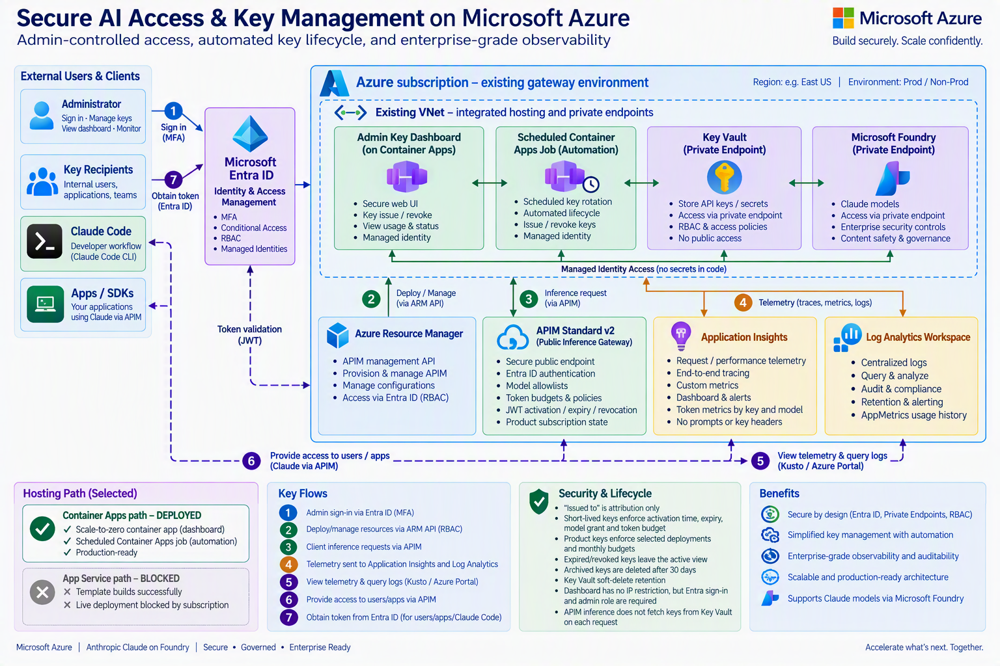
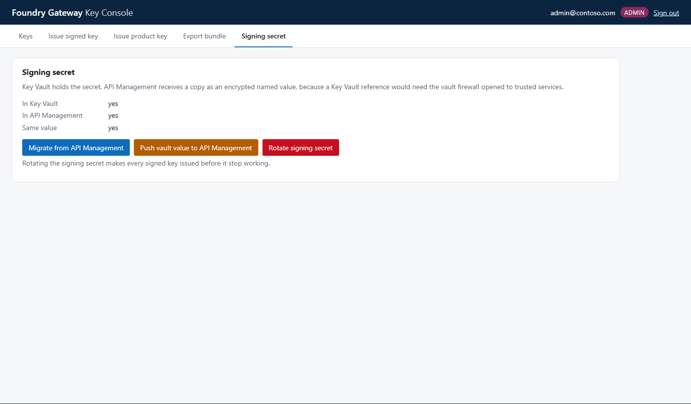

# Key Dashboard: install and setup

This guide installs the Key Dashboard next to the gateway, from an empty resource group to a
first key used by Claude Code. Each step names the script or template that does the work and the
document with the details.

| Step | Result | Time |
|---|---|---|
| [0. Try it locally](#0-try-it-locally-no-azure) | The real UI on sample data, no Azure | 1 min |
| [1. Network, Foundry and APIM](#1-network-foundry-and-api-management) | VNet, private Foundry, APIM Standard v2 | 45–60 min |
| [2. Gateway](#2-gateway) | Short-lived key routes `/v1` and `/claude` | 5 min |
| [3. Product routes and Key Vault](#3-product-routes-and-key-vault) | Product key routes `/poc/*`, private vault | 10 min |
| [4. Dashboard](#4-dashboard) | Dashboard, automation, sign-in | 10 min |
| [5. First sign-in](#5-first-sign-in) | Signing secret in Key Vault | 1 min |
| [6. Issue and use a key](#6-issue-and-use-a-key) | A key working in Claude Code | 5 min |

Decisions: [ADR-0013](adr/0013-admin-console.md), [ADR-0014](adr/0014-console-on-container-apps.md),
[ADR-0015](adr/0015-key-dashboard.md), [ADR-0016](adr/0016-admin-only-short-lived-keys.md),
[ADR-0019](adr/0019-admin-gateway-url.md).
Day-to-day use: [CONSOLE.md](CONSOLE.md).

---

## Architecture



In the illustration, key recipients obtain a token from Entra ID (flow 7) and APIM validates
Entra tokens. In this design they do not. A recipient has no Entra role. The administrator
gives each recipient a key issued by the dashboard, and APIM checks that key:

- a **short-lived key** is an HS256 JWT signed with the gateway's secret, sent as
  `Authorization: Bearer`;
- a **product key** is an APIM subscription key, sent as `x-api-key` (Claude route) or `api-key`
  (OpenAI route).

Entra ID signs in **administrators** to the dashboard. The diagram below shows the same design as
text:


---

## Requirements

| Requirement | Why |
|---|---|
| An Azure subscription, a region with Claude on Foundry (this guide uses `eastus2`) | Every resource is created there |
| Contributor and User Access Administrator (or Owner) on the resource group | The templates create resources and role assignments |
| Permission to create an Entra app registration and assign its app roles | The dashboard's sign-in ([`Deploy-Console.ps1`](../scripts/Deploy-Console.ps1)) |
| Subscription custom-role definition and role-assignment privileges for the installer | The dashboard's discovery role has only `Microsoft.CognitiveServices/accounts/read` and `Microsoft.CognitiveServices/accounts/deployments/read`; no inference, account keys or RBAC writes |
| PowerShell 7, Azure CLI 2.60+ signed in (`az login`), Node.js 20+ | The scripts and the local demo |
| Quota for Container Apps (the default) or for an App Service plan B1 | The dashboard host; App Service quota was 0 in the test subscription ([U40](UNKNOWNS.md)) |

On a shared machine, use a separate Azure CLI profile so another `az login` cannot switch the
account mid-install. `Deploy-Console.ps1` refuses to run when the CLI's active tenant differs from
the subscription's:

```powershell
$env:AZURE_CONFIG_DIR = "$HOME/.azure-keydashboard"
az login
az account set --subscription <subscription>
```

---

## 0. Try it locally (no Azure)

```powershell
git clone -b release/key-dashboard https://github.com/naveenneog/foundry-hackathon-gateway
cd foundry-hackathon-gateway
npm run dashboard:demo        # http://127.0.0.1:8090/
```

[`scripts/dashboard-demo.mjs`](../scripts/dashboard-demo.mjs) runs the real server and UI against
the in-memory fakes the unit tests use, with seeded keys and synthetic usage. Every request is
treated as a signed-in admin, so it listens on `127.0.0.1` only. Nothing is sent to Azure, and
issued keys are not valid at any gateway. `PORT=8091` changes the port.

---

## 1. Network, Foundry and API Management

The dashboard runs inside the gateway's VNet, where Key Vault and Foundry are reachable through
private endpoints. [`infra/examples/private-foundry-test.bicep`](../infra/examples/private-foundry-test.bicep)
creates the whole environment in one resource group:
- the VNet and subnets;
- a Foundry account with an OpenAI-route and a Claude deployment;
- the Foundry private endpoint and DNS zones;
- an APIM Standard v2 instance with VNet integration.

The commands, and how to use resources you already have, are in
[PRIVATE-ENDPOINT.md → Steps with the Azure CLI](PRIVATE-ENDPOINT.md#steps-with-the-azure-cli).

```powershell
az group create -n <rg> -l eastus2 -o none
az deployment group create -g <rg> --template-file infra/examples/private-foundry-test.bicep --parameters "@params.json"
```

APIM Standard v2 takes 30–45 minutes to create. The Claude route needs a v2 tier
([ADR-0009](adr/0009-claude-code-connection.md)).

## 2. Gateway

```powershell
./admin.ps1
#  1  Deploy / update the gateway    -> pick the Standard v2 instance and the Foundry account
```

This publishes the short-lived key routes (`/v1`, `/claude`), the policies and the signing secret,
and pins the first model aliases. It is the same deployment as the terminal workflow
([RUNBOOK.md](RUNBOOK.md)).

## 3. Product routes and Key Vault

Product keys use the routes, products and private Key Vault from the products proof of concept
([poc/products-keyvault/SETUP.md](../poc/products-keyvault/SETUP.md)):

```powershell
$target = @{ Subscription = '<subscription>'; ResourceGroup = '<rg>' }
./poc/products-keyvault/scripts/Deploy-Poc.ps1 @target -ApimName <apim> -FoundryAccountName <foundry-account>
# Creates the vault's private endpoint and its DNS zone link in the VNet:
./poc/products-keyvault/scripts/Invoke-PocRunner.ps1 @target -VaultName <vault-name> -Step Deploy
```

`Deploy-Poc.ps1` prints the vault name. The vault is created with public network access
disabled. The dashboard reaches it through the private endpoint and DNS zone that the runner's
`Deploy` step creates. The runner VM is needed only for the POC's own scripts; deallocate it
afterwards:

```powershell
az vm deallocate -g <rg> -n vm-poc-runner --no-wait
```

## 4. Dashboard

```powershell
# Default: Container Apps. The dashboard scales to zero; a scheduled job runs the automation.
./scripts/Deploy-Console.ps1 -Subscription <subscription> -ResourceGroup <rg>

# Options
#   -Admins ops1@contoso.com,ops2@contoso.com   more administrators (Console.Admin)
#   -AllowedIp 203.0.113.7                       accept only this address (or a /24-/32 range)
#   -Hosting AppService                          web app + Function App timer on one B1 plan
```

[`Deploy-Console.ps1`](../scripts/Deploy-Console.ps1) finds the APIM instance, the vault, the
Foundry account, the gateway's workspace and the VNet in the resource group. It then:

1. Creates the app registration `hackgw-key-console`, with "assignment required", and assigns
   you and any `-Admins` the `Console.Admin` role.
2. Records per-user sign-in consent for each administrator, for tenants that block user consent.
   If that fails, a tenant admin grants consent to the app once.
3. Adds token-usage diagnostics to the product routes
   ([`infra/console-telemetry.bicep`](../infra/console-telemetry.bicep)); no headers or bodies
   are logged.
4. Deploys **one** hosting path:
   - **ContainerApps**: builds the image in Azure Container Registry with ACR Tasks (no local
     Docker), then deploys [`infra/console.bicep`](../infra/console.bicep);
   - **AppService**: deploys [`infra/console-appservice.bicep`](../infra/console-appservice.bicep)
     and zip-deploys the dashboard and [`functions/`](../functions/).
5. Waits for `/healthz` and prints the URL.

The installer also grants a subscription-scoped **metadata-only discovery role** to the
dashboard identity. It does not grant subscription Reader/Contributor or role-assignment rights.
This is why the deployed-model list can cover Foundry accounts in other resource groups.

| Created | Container Apps path | App Service path |
|---|---|---|
| Dashboard | Container app, scale 0–1, built-in Entra sign-in | Linux web app, built-in Entra sign-in |
| Automation, every 15 min | Container Apps job | Function App timer on the same plan |
| Network | Subnet `snet-console` (10.61.5.0/27) | Subnet `snet-appsvc` (10.61.6.0/27) |
| Also | Registry (admin user off), pull identity, log workspace | Storage account (shared keys off) |
| Dashboard identity roles | Key Vault Secrets Officer and Crypto Officer, API Management Service Contributor, Reader on Foundry, Log Analytics Data Reader | Same |
| Automation identity roles | Key Vault Secrets Officer, API Management Service Contributor | Same, plus its host storage |

The dashboard has no client secret and no registry password. It uses managed identities only.
With no `-AllowedIp`, the dashboard accepts any address and Entra sign-in with the
`Console.Admin` role is required for every request except `/healthz`.

## 5. First sign-in

Open the printed URL and sign in. Then open **Settings** and, under **Signing secret**, click
**Migrate from API Management**. This copies the gateway's signing secret into Key Vault, where
the dashboard signs short-lived keys. Keys already issued keep working. The card then shows
**Copies match: Yes**.



The screenshot predates P59, when the signing secret had a page of its own; it is now a card on
**Settings**.

**Optional: a custom domain in handed-out keys.** Keys name API Management's own URL. To hand
them out with a custom domain instead, add it to API Management's Gateway endpoint (Azure portal,
the API Management instance, **Custom domains**), then choose it under **Gateway URL** on
**Settings**. The dashboard accepts only a gateway custom domain of this API Management. Details:
[CONSOLE.md](CONSOLE.md#gateway-url-custom-domain).

## 6. Issue and use a key

**Select a Foundry backend.** **Foundry & models** lists the Foundries connected to API
Management; select one and inspect its deployments. Refresh from Azure picks up new deployments.
The configured original account is already connected. Other accounts in the subscription are
listed in **Connect another Foundry** and are attached explicitly. For another account, run the
displayed operator command to grant APIM inference access:

```powershell
pwsh scripts/Connect-Foundry.ps1 -Subscription <subscription> -ResourceGroup <apim-rg> `
  -ApimName <apim> -FoundryAccountId <full-account-resource-id>
```

An optional private endpoint may be needed when the gateway uses private DNS:

```powershell
pwsh scripts/Connect-Foundry.ps1 -Subscription <subscription> -ResourceGroup <apim-rg> `
  -ApimName <apim> -FoundryAccountId <full-account-resource-id> `
  -ConfigurePrivateEndpoint -VnetName <gateway-vnet>
```

This operator action adds account-specific connectivity in the existing VNet. It does not
change public-network access or firewall rules. It can incur private endpoint charges. Pin a
ready model and use **Test** to verify inference access before distributing keys. The dashboard
help highlights the relevant controls and explains metadata access versus inference access.

**A short-lived key.** **Short-lived keys → Issue one**:
1. Select the attached Foundry. Fill in **Issued to**, a subject, and **One model** (for example `haiku-4-5`).
2. Set **Starts in** 0, **Valid for** 48 hours, and a token budget.
3. Click **Issue key**, then **Copy**. The key is shown once.

For Claude Code, set these in the project's `.claude/settings.json` `env` block, or export them:
The values below show the original account's route. An attached account includes
`/foundry/<connection-id>` before `/claude` or `/poc/claude`; the dashboard's handout and CSV
already contain that prefix. Copy those values rather than constructing the URL manually.

```bash
ANTHROPIC_BASE_URL=https://<apim>.azure-api.net/claude
ANTHROPIC_AUTH_TOKEN=<short-lived key>
ANTHROPIC_MODEL=haiku-4-5
```

**A product key.** **Product keys → Issue one**:
1. Select the attached Foundry, one or several of its deployments, and a monthly budget.
2. Click **Issue product key**, then **Reveal** it in the list.

```bash
ANTHROPIC_BASE_URL=https://<apim>.azure-api.net/poc/claude
ANTHROPIC_API_KEY=<product key>
ANTHROPIC_MODEL=claude-haiku-4-5        # a deployment name the key grants
```

**Check it.** `curl` returns 200 for a granted model and 403 for any other:

```bash
curl -sS https://<apim>.azure-api.net/claude/v1/messages \
  -H "Authorization: Bearer $KEY" -H "anthropic-version: 2023-06-01" -H "content-type: application/json" \
  -d '{"model":"haiku-4-5","max_tokens":16,"messages":[{"role":"user","content":"Reply with: ok"}]}'
```

Usage appears under the key a few minutes after the call (Application Insights ingestion).

**Many keys.** **Issue in bulk**:
1. Paste or upload `owner,subject` rows (short-lived keys) or `owner,name` rows (product keys).
2. Click **Check rows**, then **Issue**.
3. Download `keys.csv`, which holds every key in the batch, and `index.csv`, which holds no keys.
4. Send each person only their own row, then delete `keys.csv`.

[CONSOLE.md](CONSOLE.md) covers revoke, rotate, suspend, archive, model pinning, usage and
encrypted bundles.

---

## Troubleshooting

| Symptom | Cause and fix |
|---|---|
| Sign-in shows "Need admin approval" | The tenant blocks user consent and the per-user grant failed. A tenant admin grants consent to `hackgw-key-console` once. |
| Signed in, page says "Administrators only" | The account lacks `Console.Admin`. Re-run `Deploy-Console.ps1 -Admins <upn>` or assign the role in Entra (Enterprise applications → `hackgw-key-console` → Users and groups). |
| `Deploy-Console.ps1` stops: "active account is in a different tenant" | Another `az login` switched the CLI account. Run `az account set --subscription <subscription>` or use a separate `AZURE_CONFIG_DIR`. |
| `InternalSubscriptionIsOverQuotaForSku` with `-Hosting AppService` | No App Service quota in the region. Use the default Container Apps path or request quota. |
| A browser POST returns a bodyless 403 | Platform sign-in needs a same-origin `Referer`; the dashboard sends `Referrer-Policy: same-origin`. A browser extension or proxy that strips `Referer` causes it ([ADR-0014](adr/0014-console-on-container-apps.md)). |
| Usage shows 0 right after a call | Metrics reach Log Analytics a few minutes after the call. |
| Only the original Foundry's models appear | Foundry & models lists connected Foundries only; other accounts appear in **Connect another Foundry**. If that list is empty too, upgrade/redeploy this branch so the dashboard receives the metadata-only subscription discovery role, then select **Refresh from Azure**. |
| An account's deployments show an access error | The dashboard identity lacks account/deployment metadata-read permission. The installer reports whether its discovery role was granted; no account-key access is needed. |
| Attached backend test reports DNS failure | The account's public hostname may CNAME into a linked private DNS zone that has no record for that account. Use the optional private-endpoint setup command and test again; do not relax the account's firewall. |
| A product key returns 401 right after issue or rotation | APIM applies key changes within about 20 seconds (16 s measured). |

## Remove

The dashboard adds these resources to the resource group; deleting them removes it and leaves
the gateway running:

- **Container Apps path:** `ca-console-<suffix>`, `job-ca-console-<suffix>`,
  `cae-ca-console-<suffix>`, `crconsole<suffix>`, `id-ca-console-<suffix>-pull`,
  `log-ca-console-<suffix>`, subnet `snet-console`.
- **App Service path:** `app-keys-<suffix>`, `func-app-keys-<suffix>`, `asp-app-keys-<suffix>`,
  the storage account, subnet `snet-appsvc`.
- **Both paths:** the `hackgw-key-console` app registration and the `applicationinsights`
  diagnostics on `poc-claude` and `poc-openai`.
- **Keys:** Key Vault secrets are soft-deleted and stay recoverable for the vault's retention
  period.
